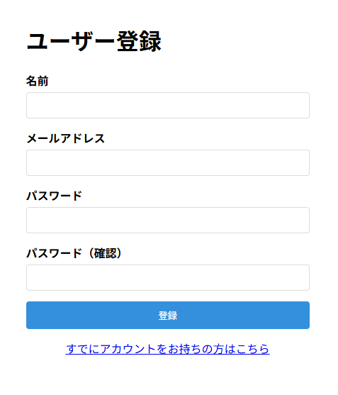
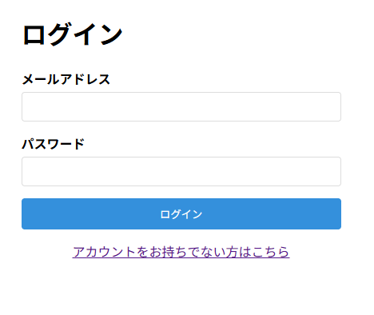
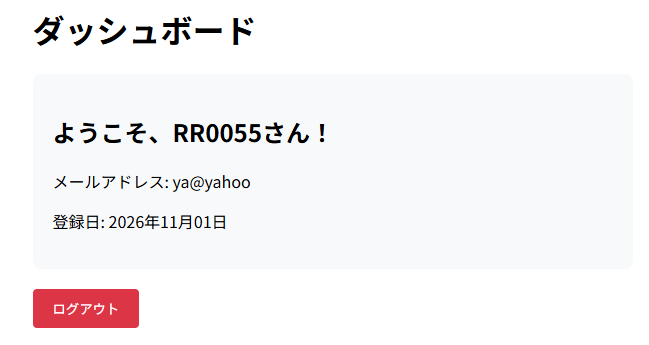

# auth-app-practice

## 概要
COACHTECH 教材 Tutorial 10-1「認証機能 ハンズオン演習」で作成した成果物です。

Fortifyを使ったユーザー登録画面を作った。

## 使用技術
PHP 8.5 
Laravel 10.x 
Laravel Fortify（認証） 
MySQL

## 学んだこと
・Fortifyの役割を学んだが、また理解が出来ていない。 
・authミドルウェアといったものがどういうものかわかっていない。 
・何から行っていくのか手順を理解する。

## 動作確認
ブラウザで動作確認を行った。 
 
 
 
 
 
